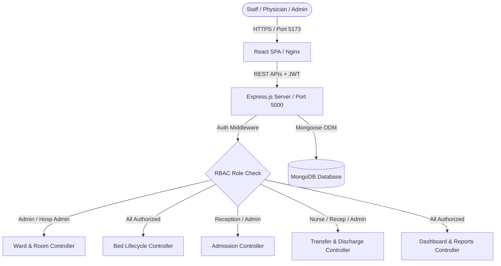
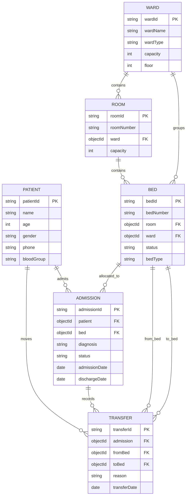

# CareConnect – Hospital Bed Availability and Admission Management Portal

**Student Roll Number:** 2303A51919  
**Course:** DevOps & Full Stack Development  
**Academic Year:** 2026–2027  
**Batch:** 28  

---

## 1. Project Overview
**CareConnect** is an enterprise-grade hospital management system designed to solve the critical challenges of bed allocation, patient admissions, inter-ward transfers, discharge tracking, and sanitized bed turnaround in high-demand healthcare environments.

---

## 2. Abstract
In contemporary healthcare administration, delays in bed allocation lead to prolonged emergency room wait times and suboptimal utilization of clinical infrastructure. CareConnect bridges this gap by unifying hospital wards, rooms, and individual beds into a synchronized, real-time database-driven portal. Featuring full role-based access control (RBAC), multi-stage bed lifecycle tracking (Available, Occupied, Cleaning, Maintenance), dynamic statistics, CSV report export, and containerized deployment manifests for Docker and Kubernetes, the application is engineered for production-grade reliability.

---

## 3. Objectives
- Provide real-time visibility into bed occupancy across all hospital wards and rooms.
- Prevent duplicate bed allocations and conflicting patient admissions through strict database-level validation.
- Automate the bed release lifecycle: upon patient discharge or transfer, beds transition into a mandatory "Cleaning" status before returning to "Available".
- Enforce strict Role-Based Access Control (Admin, Hospital Administrator, Receptionist, Nurse).
- Provide printable and exportable audit registers for admissions, discharges, bed inventories, and occupancy rates.
- Containerize and orchestrate the full stack using Docker Compose and Kubernetes.

---

## 4. Problem Statement
Hospitals frequently suffer from disconnected manual registers or legacy spreadsheets:
1. Bed status mismatches leading to multiple patients being directed to the same bed.
2. Discharged beds remaining marked as unavailable due to lack of visibility into sanitization workflows.
3. Lack of role differentiation exposing sensitive operational functions to unauthorized personnel.
4. Absence of instant aggregated metrics for hospital administrators.

---

## 5. Functional Requirements
1. **User Authentication & RBAC:** Secure JWT token issuance with password hashing via bcryptjs. Four distinct roles with granular permissions.
2. **Live Dynamic Dashboard:** Aggregated metrics from MongoDB displaying total beds, available beds, occupied beds, cleaning status, active inpatients, discharged history, and ward-wise occupancy progress.
3. **Ward Management:** CRUD operations for hospital wards with capacity tracking, floor association, and safe deletion checks preventing deletion if dependent rooms or beds exist.
4. **Room Management:** CRUD operations with ward association, capacity validation, and bed occupancy calculations.
5. **Bed Management:** Individual bed status transitions (Available, Occupied, Cleaning, Maintenance) with guards preventing manual override of occupied beds.
6. **Patient Management:** Patient registration with 10-digit phone validation, demographic editing, and complete medical admission/transfer history view.
7. **Admission Workflow:** Cascading selectors (Ward -> Room -> Available Bed) allocating beds to "Occupied" atomically.
8. **Transfer Workflow:** Patient bed transfer with destination validation and automatic transition of source bed to "Cleaning".
9. **Discharge Workflow:** Admission discharge with clinical notes, timestamp recording, and automatic bed transition to "Cleaning".
10. **Reports & Exports:** Real-time generation of Bed Occupancy, Available Beds, Patient Admissions, and Discharge Reports with CSV download and clean print layouts.
11. **Settings & Profile:** Password change verified by backend bcrypt comparison and hospital institutional profile settings.

---

## 6. Non-Functional Requirements
- **Security:** Passwords hashed with salt rounds (bcrypt), protected API routes using JWT Bearer authentication, zero secret leakage in version control.
- **Data Integrity:** Mongoose schema validations, cascade safety checks preventing orphaned records.
- **Performance:** Sub-second API response times; client-side bundle under 3s build time via Vite.
- **Portability:** Containerized microservices using Docker and orchestrated via Kubernetes.
- **Usability:** Responsive healthcare blue UI theme (`#2563eb`), clear status badges, empty states, and loading indicators.

---

## 7. Technology Stack
- **Frontend:** React 19, Vite 8, Lucide React icons, Recharts, Responsive CSS
- **Backend:** Node.js, Express.js 5, Mongoose 9, JWT (`jsonwebtoken`), bcryptjs, CORS
- **Database:** MongoDB 7.0
- **DevOps:** Docker, Docker Compose, Kubernetes manifests, Nginx reverse proxy

---

## 8. System Architecture
```
+-------------------------------------------------------------+
|                      Client Browser                         |
|   React 19 SPA (Vite) + Recharts + Lucide + Responsive CSS  |
+------------------------------+------------------------------+
                               |  HTTP / REST (Bearer JWT)
                               v
+-------------------------------------------------------------+
|               Nginx Web Server / Gateway (Port 80)          |
+------------------------------+------------------------------+
                               |  Reverse Proxy
                               v
+-------------------------------------------------------------+
|             CareConnect Express API (Port 5000)             |
|  - Auth & RBAC Middleware       - Admission Controller      |
|  - Ward & Room Controllers      - Transfer & Discharge      |
|  - Bed Lifecycle Controller     - Dashboard Aggregation     |
+------------------------------+------------------------------+
                               |  Mongoose ODM
                               v
+-------------------------------------------------------------+
|                   MongoDB Database (Port 27017)             |
|  Collections: users, wards, rooms, beds, patients,          |
|               admissions, transfers                         |
+-------------------------------------------------------------+
```

---

## 9. Architecture Diagram (Mermaid)


---

## 10. Database Design & Collections
1. **users:** `_id`, `name`, `email` (unique), `password` (bcrypt hash), `role` (Enum: Admin, Hospital Administrator, Receptionist, Nurse)
2. **wards:** `_id`, `wardId` (unique), `wardName`, `wardType`, `floor`, `capacity`, `description`
3. **rooms:** `_id`, `roomId` (unique), `roomNumber`, `ward` (ref Ward), `floor`, `capacity`
4. **beds:** `_id`, `bedId` (unique), `bedNumber`, `room` (ref Room), `ward` (ref Ward), `status` (Available, Occupied, Cleaning, Maintenance), `bedType`
5. **patients:** `_id`, `patientId` (unique), `name`, `age`, `gender`, `phone`, `address`, `bloodGroup`
6. **admissions:** `_id`, `admissionId` (unique), `patient` (ref Patient), `bed` (ref Bed), `admissionDate`, `diagnosis`, `admittedBy`, `status` (Admitted, Transferred, Discharged), `dischargeDate`, `dischargeNotes`
7. **transfers:** `_id`, `transferId` (unique), `patient` (ref Patient), `admission` (ref Admission), `fromBed` (ref Bed), `toBed` (ref Bed), `transferDate`, `reason`

---

## 11. Entity-Relationship (ER) Diagram


---

## 12. Module Description
- **Authentication & RBAC:** Protects every operational endpoint. Signs JWT tokens with 1-day validity.
- **Dashboard:** Fetches real database metrics dynamically, displaying occupancy rates, Recharts donut distribution, and recent activity.
- **Ward Management:** Ward inventory, floor allocation, and safety enforcement against orphaned rooms.
- **Room Management:** Room capacity vs. bed count synchronization and floor alignment.
- **Bed Management:** Granular status indicators (Available, Occupied, Cleaning, Maintenance) and quick sanitization buttons.
- **Patients:** Demographic management, 10-digit mobile verification, and multi-admission audit history.
- **Admissions:** Cascading bed selection and atomic status updates.
- **Transfers & Discharge:** Bed swaps, release of beds to cleaning, and clinical discharge notes.
- **Reports:** Filterable tabular reports with instant CSV export and clean print view.
- **Settings:** Hospital profile storage and backend password updates.

---

## 13. Authentication Design
Authentication uses standard Bearer JWT authorization.
- Token format: `Authorization: Bearer <token>`
- Token payload: `{ id: user._id, role: user.role }`
- Verification middleware validates user existence in MongoDB on every request.
- Central client (`api.js`) handles 401 Unauthorized responses by clearing expired sessions and routing to the Login portal.

---

## 14. API Documentation
All routes mounted under `/api`:
- `POST /api/auth/login`: Authenticate user
- `POST /api/auth/register`: Create user account
- `GET /api/auth/me`: Fetch authenticated user profile
- `PUT /api/auth/change-password`: Update password
- `GET /api/dashboard/stats`: Real-time aggregated hospital statistics
- `GET /api/wards`: Retrieve all wards
- `POST /api/wards`: Create ward
- `PUT /api/wards/:id`: Update ward
- `DELETE /api/wards/:id`: Safe delete ward
- `GET /api/rooms`: Retrieve all rooms
- `POST /api/rooms`: Create room
- `PUT /api/rooms/:id`: Update room
- `DELETE /api/rooms/:id`: Safe delete room
- `GET /api/beds`: Retrieve all beds
- `POST /api/beds`: Create bed
- `PUT /api/beds/:id`: Update bed or cleaning status
- `DELETE /api/beds/:id`: Safe delete bed
- `GET /api/patients`: Retrieve patients
- `POST /api/patients`: Register patient
- `GET /api/patients/:id`: Retrieve patient with full history
- `PUT /api/patients/:id`: Update patient
- `DELETE /api/patients/:id`: Safe delete patient
- `GET /api/admissions`: Retrieve admissions
- `POST /api/admissions`: Create admission & allocate bed
- `POST /api/transfers`: Transfer bed & set old bed to Cleaning
- `PUT /api/discharges/:id`: Discharge patient & set bed to Cleaning

---

## 15. Admission Workflow
1. Select registered patient (must not have an active admission).
2. Filter available beds by ward and room.
3. Select an Available bed.
4. Provide diagnosis and admitting physician.
5. Create admission record; backend atomically transitions bed status to `Occupied`.

---

## 16. Transfer Workflow
1. Select an actively admitted patient.
2. Select destination bed from Available beds inventory.
3. Provide clinical transfer reason.
4. Backend updates admission reference to destination bed.
5. Destination bed becomes `Occupied`; source bed transitions to `Cleaning`.

---

## 17. Discharge Workflow
1. Select active admission record.
2. Provide clinical discharge summary / notes.
3. Backend records discharge timestamp and sets status to `Discharged`.
4. Assigned bed status transitions to `Cleaning`.

---

## 18. Bed Availability Logic
- Only beds with status `Available` can be allocated to admissions or transfers.
- Beds with status `Occupied`, `Cleaning`, or `Maintenance` are blocked.
- When an admitted patient leaves a bed (via discharge or transfer), the bed enters `Cleaning`.
- Nursing staff click "Complete Cleaning" to return the bed to `Available`.

---

## 19. Reports
- **Bed Occupancy Report:** Real-time summary of all beds, wards, rooms, types, and statuses.
- **Available Bed Report:** Filtered inventory of ready-for-intake beds.
- **Patient Admission Report:** Audit log of all admissions with diagnosis and admitting physician.
- **Discharge Report:** Register of completed patient discharges with discharge dates and notes.
- Features: Real-time search, ward filter, date range filter, CSV file download, and clean print styling.

---

## 20. Testing & Verification
Automated test scripts in `backend/scripts/`:
- `verify_workflow.js`: 15-step end-to-end integration test (Ward -> Room -> Beds -> Patient -> Admission -> Occupancy verification -> Transfer -> State verification -> Discharge -> Cleaning verification -> Cleaning completion -> Availability verification -> Dashboard sync -> Report sync).
- `verify_roles.js`: RBAC permission tests verifying Nurse bed status updates and blocking unauthorized operations.
- **Result:** 100% Passed.

---

## 21. Installation & Local Execution
```bash
# Clone or navigate to repository
cd C:\Users\user\hospital-bed-management

# Backend
cd backend
npm install
node scripts/seedUsers.js
npm run dev

# Frontend (in separate terminal)
cd ../frontend
npm install
npm run dev
```
Open browser at `http://localhost:5173`.

---

## 22. GitHub Instructions
```bash
git remote add origin <YOUR_GITHUB_REPOSITORY_URL>
git branch -M main
git push -u origin main
```

---

## 23. Docker Instructions
```bash
docker compose build
docker compose up -d
docker compose ps
docker compose logs -f
docker compose down
```

---

## 24. Kubernetes Instructions
```bash
# Apply all Kubernetes manifests (ConfigMap, Secret, Deployments, and Services)
kubectl apply -f k8s/

# Verify cluster resources
kubectl get deployments
kubectl get pods
kubectl get services
```

---

## 25. Conclusion & Future Enhancements
CareConnect successfully demonstrates the development of a complete full-stack hospital bed availability and admission management application, integrating React.js, Node.js, Express.js, and MongoDB with Docker containerization and Kubernetes deployment. The application provides efficient hospital resource management, secure role-based access control, real-time dashboard statistics, and streamlined patient admission, transfer, and discharge workflows. Its modular architecture, automated testing, and containerized deployment establish a reliable foundation for future development and scalability.

Future enhancements may include HL7/FHIR-based Electronic Health Record (EHR) integration, automated SMS notifications for patient attendants, IoT-enabled smart bed sensor telemetry, AI-assisted bed allocation optimization, and cloud-based deployment with enhanced monitoring and scalability.
